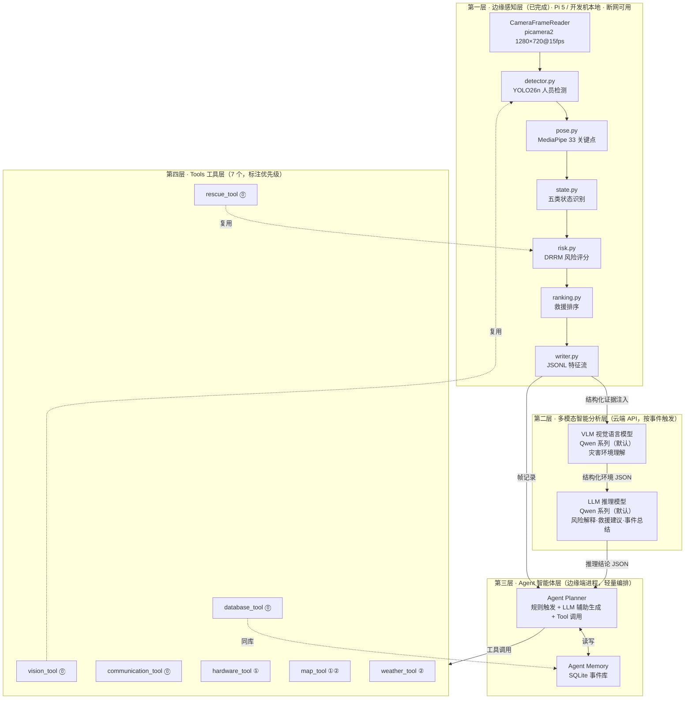
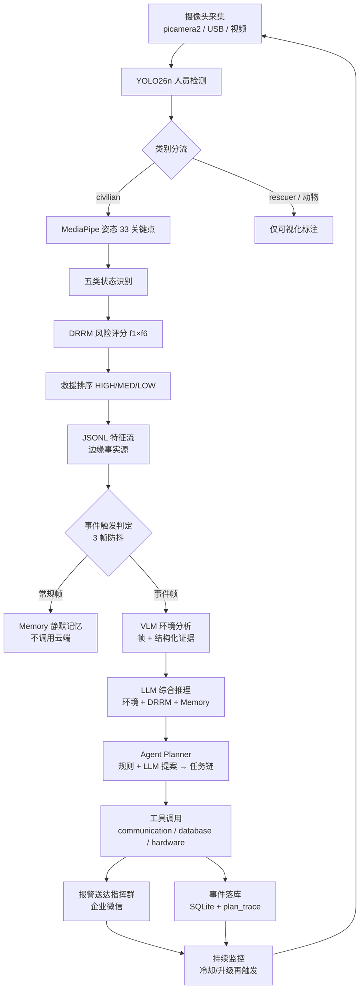

# 城市灾害·边缘哨兵

## ——基于多模态智能体的灾害现场人员感知与救援决策辅助系统 PRD

| 文档属性 | 内容 |
|---|---|
| 项目名称 | Disaster_Rescue_DRRM（城市灾害·边缘哨兵） |
| 文档版本 | V3.1（PRD，新增"创新功能规划与实现优先级"阅读入口章节） |
| 编写日期 | 2026-09-18 |
| 文档状态 | 评审稿 |
| 适用阶段 | 算法创新大赛 · 项目规划 + 开发指导 |
| 代码基线 | V1.0 边缘感知系统（已完成，即仓库 V0.1.5 + V0.2-M0） |
| 冲刺目标 | **V4.0 MVP**：15 天内交付完整多模态智能救援辅助 Demo 闭环 |
| 部署形态 | 边缘端 Raspberry Pi 5 / Windows 开发机 + 云端 VLM/LLM API |

**如何使用本文档**：快速理解本项目 → 第一、二章（定位 + 创新功能规划与优先级，5 分钟读完）；给老师/评审看 → 再看第四、五章（架构、优先级）+ 十二章（版本规划）；作为 Claude Code 开发指导 → 第六~十章（15 天计划、MVP 定义、代码架构、API、数据结构）。

---

## 一、项目定位

### 1.1 一句话定位

**面向救援人员的智能决策辅助系统**：在树莓派 5 上运行的、能看懂灾害现场、能自主完成报警通知与事件记录等辅助操作的边缘智能哨兵。

### 1.2 能力演进：从感知系统到智能辅助系统

```
当前（已完成）                    升级（15 天冲刺目标）
┌─────────────────────┐          ┌─────────────────────────────────┐
│  边缘 AI 灾害感知系统  │   ──→   │   多模态智能救援辅助系统           │
│                     │          │                                 │
│  YOLO26n 人员检测     │          │  感知（已有）                     │
│  MediaPipe 姿态      │          │    ↓                            │
│  五类人体状态识别      │          │  理解（VLM 灾害环境分析）           │
│  DRRM 风险评分        │          │    ↓                            │
│  救援优先级排序        │          │  推理（LLM 风险解释与救援建议）      │
│                     │          │    ↓                            │
│  输出：谁最危险        │          │  行动（Agent 编排工具完成           │
│                     │          │       信息通知/事件记录等辅助操作）   │
└─────────────────────┘          └─────────────────────────────────┘
```

四级闭环：**感知 → 理解 → 推理 → 行动**。感知层已完成并经过标定验证；本次升级补齐后三级，且行动严格限定为信息类辅助操作。

### 1.3 系统边界声明（全文表述口径）

本系统是**面向救援人员的智能决策辅助系统**。全文（含论文、PPT、答辩材料）统一遵守：

| ❌ 禁用表述 | ✅ 规范表述 |
|---|---|
| Agent 自动完成救援任务 | Agent 生成救援辅助任务，并调用工具完成信息通知、事件记录等辅助操作 |
| 自动规划救援路线 | 基于地图服务辅助提供空间信息和路线参考 |
| 实现智能救援调度 | 实现面向救援人员的智能决策辅助 |

**行动边界**：系统可自主执行的动作仅限信息类辅助操作（报警通知、事件落库、现场示警、环境查询）；**救援决策权与执行权始终在救援人员**。此边界同时是安全设计（4.4.1 节动作白名单）与伦理声明。

### 1.4 大赛定位与差异化

本系统不是"调 API 的演示项目"，差异化在三点：

- **边缘-云协同**：自研轻量 CV 管线（YOLO26n 自训练权重 + 15 维姿态几何特征 + DRRM 公式化风险模型）跑在边缘端，VLM/LLM 按事件触发增量介入，断网时纯边缘模式仍完成检测-评分-排序-本地报警；
- **结构化证据注入**：VLM 输入是"原始帧 + 边缘端结构化证据"，小模型的确定性与大模型的开放理解各司其职、结果可审计；
- **闭环而非流水线**：Agent 以"规则触发 + LLM 辅助生成 + 工具调用"的轻量编排，完成从画面到报警、落库的完整行动链。

---

## 二、创新功能规划与实现优先级（阅读入口）

> **本章是全文阅读入口**，一次性回答四个问题：项目已完成什么（2.1）、本次新增哪些创新功能（2.2）、V4.0 MVP 必须实现哪些（2.2）、哪些属于后续扩展（2.3）。此处只给结论与优先级，技术细节见第四~十章。

### 2.1 项目创新升级路线

**已有边缘 AI 灾害感知系统（V1.0，已完成并经标定验证）**：

```
Raspberry Pi 5 + YOLO26n 人员检测 + MediaPipe 姿态 + 五类人体状态识别
+ DRRM 风险评分 + 救援优先级排序
```

**本次升级为多模态智能救援辅助系统（V4.0 MVP）**：

```
边缘感知（已有）
    ↓
VLM 灾害环境理解（新增）
    ↓
LLM 风险推理（新增）
    ↓
Agent 智能编排（新增）
    ↓
Tools 工具调用（新增）
    ↓
通信报警与事件记忆（新增）
```

**突出**：本项目**不是简单调用大模型 API**，而是在已有边缘视觉系统基础上增加多模态智能分析与智能体闭环：

- 边缘端自研 CV 管线完整保留（YOLO26n 自训练权重 + 15 维几何特征 + DRRM 公式化评分），断网仍可独立完成检测-评分-排序-本地报警；
- VLM/LLM 的输入是"原始帧 + 边缘端结构化证据"的融合注入，输出强约束 JSON——小模型确定性与大模型开放理解各司其职、结果可审计；
- Agent 以"规则触发 + LLM 辅助生成 + 工具调用"轻量编排完成信息行动闭环（报警通知、事件记录等辅助操作，救援决策权始终在人）。

### 2.2 V4.0 MVP 阶段创新功能（P0）

| 优先级 | 创新模块 | 实现内容 | 项目价值 |
|---|---|---|---|
| P0 | **VLM 灾害环境理解** | 输入：原始图像 + YOLO/DRRM 结构化证据（pid/state/risk_score/bbox）；输出：灾害环境分析（8 类预定义灾种）、危险因素描述与严重度分级 | 从"看到人"升级为"看懂现场"；零样本覆盖开放灾种、免重训 YOLO；多模态融合核心创新 |
| P0 | **LLM 辅助推理** | 融合 VLM 环境结果、DRRM 风险评分、人员排序与事件记忆；输出：风险解释、救援建议、事件速报、任务提案 | 把风险数字翻译为指挥员可直接使用的自然语言建议——"决策辅助"定位的直接体现 |
| P0 | **Agent Planner** | 规则触发 + LLM 辅助生成 + 工具调用的轻量任务编排（含 3 帧防抖事件触发、30 分钟防重报冷却、动作白名单） | 智能体能力的最小可信实现；规则优先保证演示确定性（评委看到的必能复现） |
| P0 | **communication_tool** | 企业微信 Webhook 报警：markdown 结构化消息 + 现场标注图，含重试与待发队列 | 形成**发现危险后的信息通知闭环**——没有它，"行动"环节不成立 |
| P0 | **database_tool** | SQLite 事件数据库（persons / events / tasks / agent_logs 四表） | 保存灾害事件、Agent 执行日志，实现基础 Memory 能力与全过程可审计 |

**说明**：已有边缘感知系统（第一层）作为**基础能力**，已完成并经标定验证，不属于本次新增功能。

（详细设计：VLM/LLM 见 4.3 节，Agent 见 4.4 节，工具见 4.5 节；P0 完整清单与完成标准见 7.1 节。）

### 2.3 后续增强功能（P1/P2）

| 优先级 | 功能 | 说明 |
|---|---|---|
| P1 | hardware_tool | LED / 蜂鸣器 / OLED 现场示警（mock 模式随 MVP 免费获得，接真硬件约 1 天） |
| P1 | Memory 增强 | person_states / risk_history 流水表，支撑状态变化历史查询与 LLM 上下文注入 |
| P1 | Agent 推理链可视化 | 读 tasks.plan_trace 渲染 Thought-Action-Observation 时间线，答辩讲解利器 |
| P1 | map_tool 逆地理（可选） | 报警消息附中文地址，一行 API |
| P2 | map_tool 完整版 | 周边救援资源搜索、路线参考 |
| P2 | weather_tool | 和风天气 + DRRM F7 环境因子（多源融合论文扩展点，接口已冻结） |
| P2 | 更复杂时序风险融合 | tracking / TSF 时序状态机 / Static Lying / 动态 DRRM（F2/F3/F5 激活） |

**说明**：以上功能**均不影响 V4.0 MVP 闭环交付**——P1 在 15 天冲刺末期穿插（Day15），P2 全部赛后迭代，接口设计已在 PRD 冻结（见第五章）。

### 2.4 V4.0 最终 Demo 闭环

```
灾害现场
   ↓
Raspberry Pi 摄像头采集（演示可用 USB 摄像头/预录视频替代，见 7.2 节）
   ↓
YOLO26n + MediaPipe（人员检测 + 33 关键点姿态）
   ↓
状态识别 + DRRM 风险评分（五态 + f1×f6 + HIGH/MEDIUM/LOW 排序）
   ↓
高风险事件触发（HIGH / 状态突变 3 帧确认）
   ↓
VLM 环境理解（帧 + 结构化证据 → 灾种与严重度）
   ↓
LLM 生成分析建议（风险解释 + 救援建议）
   ↓
Agent 调用工具（轻量三段式编排）
   ↓
企业微信报警（含标注图的结构化消息送达指挥群）
   ↓
SQLite 事件保存（event / task / plan_trace / agent_logs）
```

此流程即 V4.0 MVP 验收主线（详见 7.4 节与验收三剧本），全程可在开发机 + mock 环境复现。

---

## 三、当前已有系统能力（V1.0 基线盘点）

以下为仓库已交付、经测试验证的能力。**后续全部新增模块建立在这些真实接口之上，不重写、不重构。**

### 3.1 人员检测（`src/detector.py`）

| 要素 | 说明 |
|---|---|
| 作用 | 灾害场景人员目标检测，产出后续全流程的 bbox 证据 |
| 输入 | BGR 图像 `np.ndarray` |
| 处理 | ultralytics `YOLO` 加载本地自训练权重 `models/disaster_best.pt`（YOLO26n 架构），`imgsz=640` 推理 |
| 输出 | `List[Detection]`：`bbox:[x1,y1,x2,y2]`（像素）、`class_id`、`class_name`、`confidence`、`is_person` |
| 接口 | `Detector(config_path=None)`；`detect_frame(image_bgr, conf_thres=None, iou_thres=None)` |

类别体系（6 类）：`civilian`(id=1) / `rescuer`(id=5) 为人员；`cat/cow/dog/horse` 为非人员。编排规则：**仅 civilian 进入姿态/状态/风险/排序管线；rescuer 只画蓝框；非人员灰框**。

### 3.2 人体姿态分析（`src/pose.py`）

| 要素 | 说明 |
|---|---|
| 作用 | 为每个 civilian 提取 33 个关键点骨架 |
| 输入 | `image_bgr` + `List[Detection]` |
| 处理 | MediaPipe Pose（`static_image_mode=True, model_complexity=1`）；按检测框 ROI 单人推理，外扩 `roi_pad_ratio=0.2`（脚部 3 倍 pad），坐标映射回原图像素 |
| 输出 | `List[PoseResult]`：`status`（"ok"/"skipped"/"no_landmarks"/"error"）、`landmarks`（33×{x,y,z,visibility}）、`visibility_mean` |
| 接口 | `PoseEstimator(config_path=None)`；`estimate_persons(image_bgr, detections)` |

### 3.3 五类人体状态识别（`src/state.py`，V0.1.9）

| 要素 | 说明 |
|---|---|
| 作用 | 推断 `Standing / Sitting / Lying / Fall / Help-Waving` |
| 输入 | 单个 `PoseResult`（status="ok"） |
| 处理 | ① 15 维 torso 归一化特征（`StateFeatures`，尺度无关）；② 五个独立几何检测器 + 贴地预检查；③ 固定优先级仲裁 |
| 输出 | `StateResult`：`state`、`confidence = (0.35+0.55×margin)×(0.4+0.6×vis)`、`features` |
| 接口 | `StateClassifier.classify(pose) -> Optional[StateResult]` |

仲裁优先级：`Fall > Help-Waving > Lying > Sitting > Standing`（if-elif 硬编码，可审计）。关键判定：

| 状态 | 核心几何条件 |
|---|---|
| Fall | (a) 贴地水平跌倒（ground_precheck + ≥2 项异常）；(b) 前扑/跪撑（躯干倾角≥35° + 膝角<125° + 大腿角<45° 或水平身体比<1.55），不需贴地预检查 |
| Help-Waving | `wrist_height_ratio ≥ 0.25`（手腕高于肩部 / torso 长） |
| Lying | 贴地预检查 + 三清洁条件（大腿角≥40° / 水平身体比≥1.50 / 膝角≥110°），分层封顶 0.45/0.70 |
| Sitting | 膝角≤125° + 大腿角≥25° + 髋膝比≥0.20 + 膝低于髋 |
| Standing | 躯干倾角<60° 且膝角≥150° |

单帧 2D 无法判"跌倒过程"，Fall 为静态几何异常判定，时序确认为 P2 扩展（见 5.4 节）。

### 3.4 DRRM 风险评分（`src/risk.py`）

| 要素 | 说明 |
|---|---|
| 作用 | 把"状态 + 证据质量"压缩为 [0,1] 风险分（Disaster Rescue Risk Model） |
| 输入 | `Detection` + `PoseResult` + `StateResult` |
| 处理 | 论文 6.4 公式 `R = Σ αᵢ·wᵢ·fᵢ`。单帧激活两因子：`f1 = 0.5 + (state_risk[state]−0.5)×state.confidence`；`f6 = max(0.25, 0.5+0.5×clip(det_conf×pose_vis,0,1))`；`risk_score = clip(f1×f6, 0, 1)` |
| 输出 | `RiskResult`：`state`、`f1`、`f6`、`risk_score` |
| 接口 | `Riskevaluator(config_path=None)`；`assess(detection, pose, state)` |

状态风险先验（config 可调）：`Fall 0.95 / Lying 0.90 / Help-Waving 0.78 / Sitting 0.55 / Standing 0.35`。**扩展预留**：F2/F3/F5 时序因子与 F7 环境因子（天气）公式位已定义，单帧下中性——DRRM 从纯视觉模型渐进式进化为多源融合模型是论文主线。

### 3.5 救援优先级排序（`src/ranking.py`）

- 排序键四级降序链：`risk_score → STATE_ORDER → det_conf → pose_vis`；
- priority 由状态直接映射：Fall/Help-Waving→HIGH，Lying→MEDIUM，Sitting/Standing→LOW（未知状态兜底阈值 0.60/0.45）；
- 输出 `RankingResult`：`rank/state/risk_score/priority/details`（f1/f6/tie_reason 可完整溯源）。

### 3.6 多输入支持（`src/main.py` / `video.py` / `camera.py`）

统一入口：`python src/main.py --config config/config.yaml [--input <path>] [--camera]`。四种模式：单图片 / 图片目录 / 视频文件（`frame_stride` 抽帧）/ 树莓派摄像头（picamera2 1280×720@15fps，`ROTATE_180`，与 VideoFrameReader 鸭子类型对齐、可注入 mock）。核心编排 `process_one()`：检测→分流→pid→姿态→状态→风险→排序→可视化（Top-K 面板）→JSON。

### 3.7 数据保存与可视化（`src/writer.py`）

- 图片 JSON（`outputs/json/`）：`persons: [{id, class_name, state, confidence, risk_score, priority, rank, f1, f6}]`；
- **JSONL 特征流**（`outputs/stream/`，`STREAM_VERSION="0.2-m0"`）：header + 帧记录 `{frame_idx, t_sec, persons:[{pid, class_name, bbox, det_conf, pose_ok, pose_vis, landmarks, state, state_conf, f1, f6, risk_score, priority, rank}]}`。

**这份特征流是 Agent 层的天然数据底座**：Agent 触发判定直接消费它，VLM 证据注入直接引用其 persons 字段——已有能力 → 智能体系统最关键的接口复用点。

### 3.8 工程现状

- 历史快照已归档至 `archive/`（2026-09-18），`src/` 仅 9 个活模块；
- `models/pose_landmarker.task` 未被代码引用，保留作 P2 升级预留；
- 检测类别仅 6 类、非人员为动物，无残骸/车辆等灾害物体类别——**这正是引入 VLM 环境理解的根本原因：环境要素识别交给云端大模型，而非重训 YOLO**。

---

## 四、系统总体架构

### 4.1 四层架构总览



（⓪=P0 核心MVP，①=P1 增强，②=P2 扩展，见第五章）

**分层原则**：

1. **边缘感知层零改动**——七个子模块保持现有接口，作为工具层底层被复用；
2. **云端只做增量理解**——VLM/LLM 无状态、按事件触发（非逐帧），成本可控；
3. **Agent 层是唯一的任务编排点**——所有对外动作（报警、落库、示警）均属信息类辅助操作，由 Planner 编排，动作前查 Memory 防重报、动作后写 agent_logs 可审计；**系统不执行任何救援动作，救援决策权始终在人**；
4. **工具层可独立测试**——每个工具自包含（输入 JSON → 输出 JSON），mock 后可脱离网络/硬件运行。

### 4.2 第一层：边缘感知层（已完成）

职责：人员检测、姿态估计、状态识别、DRRM 评分、排序、特征流输出。性能预算：单帧全管线 ≤ 500ms（YOLO26n@640 约 60–90ms + MediaPipe ROI 约 80ms×N 人 + 规则层 <5ms），`frame_stride=2` 时约 7.5fps。边缘端不依赖网络，JSONL 特征流是本地事实源。

### 4.3 第二层：多模态智能分析层

#### 4.3.1 VLM 视觉语言模型（灾害环境理解）

| 要素 | 说明 |
|---|---|
| 作用 | 理解 CV 管线看不到的灾害环境要素 |
| 输入 | ① 原始帧（JPEG base64）；② 边缘端结构化证据（persons：pid/state/risk_score/bbox）；③ 强约束 Prompt（枚举 8 类预定义灾种，禁止自由发挥） |
| 处理 | 默认 Qwen 系列 VLM（如 qwen-vl-max），经 OpenAI 兼容接口调用，`response_format=json_object` 强制 JSON；识别 building_collapse / fire / smoke / flood / obstacle / dangerous_wall / chemical_leak / none |
| 输出 | `SceneAnalysis`：`{scene_type, hazards:[{type,severity,bbox_hint,description}], overall_severity(1-5), affected_pids[], environment_note}`（Schema 见 9.1 节） |
| 接口 | `vlm/client.py: VLMClient.analyze_scene(frame_bgr, persons_evidence)` |
| **价值** | ① 零样本覆盖开放性灾种，免重训 YOLO；② 环境要素与人员风险叠加，形成"人在什么环境里"的联合判断；③ 结构化输出可直接被 Agent 消费 |

**为什么 VLM 而不是扩展 YOLO**：灾害环境要素类别开放、样本稀缺、边界模糊，规则检测器不可行。同时 VLM 输出**只影响环境系数与救援建议，不覆盖 DRRM 人员风险分**——边缘端模型的可审计性优先。

#### 4.3.2 LLM 推理模型（决策解释与建议生成）

| 要素 | 说明 |
|---|---|
| 作用 | 综合三方信息生成人类可读、可执行的救援决策辅助结论 |
| 输入 | ① VLM 环境分析；② DRRM 风险结果 + 排序表；③ Memory 近期事件摘要 |
| 处理 | 默认 Qwen 系列 LLM（如 qwen-plus），系统 Prompt 定义角色"救援指挥辅助参谋"，输出结构化 JSON |
| 输出 | `{risk_explanations[], rescue_suggestions[], event_summary, task_proposals[]}`（Schema 见 9.2 节） |
| 接口 | `llm/client.py: LLMClient.reason(scene_analysis, drrm_results, memory_digest)` |
| **价值** | ① 把 f1/f6/排序键翻译成指挥员能直接用的自然语言；② 生成可执行的救援建议；③ 提出任务提案供 Agent 编排——LLM 不直接触发动作 |

**模型服务层设计**：默认采用 Qwen 系列模型（VLM/LLM 各一），`vlm/client.py` 与 `llm/client.py` 基于 OpenAI 兼容协议抽象，**保留其他 VLM/LLM 供应商（GLM-4V、GPT-4o 等）兼容接口**，切换只需改 config 的 `provider/model` 两行。选 Qwen 作默认的理由：国内网络直连稳定、OpenAI 兼容生态成熟、大赛周期内成本可控——**模型是可替换的工程选型，不是系统设计的前提**。

### 4.4 第三层：Agent 智能体层

Agent 负责**任务编排、工具调用、事件管理**，不是替代人工。**实现路线：规则触发 + LLM 辅助生成 + Tool 调用**——不实现复杂自主循环，不引入 LangChain/AutoGen 等重框架（自研轻量编排器 <300 行），避免比赛周期消耗在 Agent 框架本身。

#### 4.4.1 Agent Planner（任务规划，轻量三段式）

```
① 规则触发    → triggers.py 判定事件（HIGH / 状态突变 / 心跳），确定性，不依赖 LLM
② LLM 辅助生成 → llm/client.py 输出 task_proposals（建议），LLM 只组织信息，不决定"报不报"
③ Tool 调用   → executor.py 按任务链调用工具，单任务工具步数上限 3，超限即终止并落库
```

任务执行链借鉴 ReAct 的 Thought-Action-Observation 结构做**过程留痕**（每步写入 `tasks.plan_trace`，供审计回放），但不做开放式自主循环。典型任务链（答辩演示主线）：

```
[触发] frame_record 显示 person_003 state=Fall risk_score=0.92 priority=HIGH

Thought 1: person_003 为 Fall 且 HIGH，需确认环境是否加剧风险。
Action 1: vision_tool.get_snapshot(person_id="person_003")
Observation 1: {state:"Fall", risk_score:0.92, bbox:[...], frame_ts:"..."}

Thought 2: 需要环境上下文判断是否为二次坍塌高危区。
Action 2: vlm_client.analyze_scene（经 planner 桥接调用）
Observation 2: {hazards:[{type:"building_collapse",severity:"high"}], overall_severity:4}

Thought 3: 环境高危 + 人员 Fall，立即报警并触发现场示警。
Action 3: communication_tool.send_alert(person_id="person_003", priority="HIGH", image=<annotated_frame_b64>)

Finish: task_id=T-20260918-001, actions=3, status=completed
```

规划策略（硬编码安全边界 + LLM 自由度结合）：

- **确定性规则优先**：出现 HIGH / 状态突变（如 Standing→Fall）→ 必须生成救援通知任务，不允许 LLM 自行决定"不报"（安全兜底）；
- **LLM 负责编排**：在必须报警的前提下，决定信息组织、是否叠加环境分析、通知措辞；
- **动作白名单**：Planner 只能调用注册工具，工具内部做参数校验，杜绝 prompt 注入导致的越权动作。

#### 4.4.2 Agent Memory（历史记忆）

SQLite（`data/drrm.db`，WAL 模式，与边缘部署匹配、零运维）。**MVP 四表**：`persons`（人员档案）、`events`（灾害/报警事件）、`tasks`（任务记录含 plan_trace）、`agent_logs`（工具调用审计）；`person_states`/`risk_history` 流水表为 P1 扩展。完整 DDL 见 9.6 节。

记忆读写接口：`agent/memory.py`：`remember_frame(frame_record)` / `digest(window_minutes=30) -> str`（LLM 注入用压缩摘要）/ `should_cooldown(person_id, state, minutes=30) -> bool`（防重报）。

### 4.5 第四层：Tools 工具层（7 个工具）

统一基类 `tools/base.py: Tool`（`name/description/schema/run()`），返回一律 JSON dict，异常返回 `{"ok": false, "error": ...}` 不中断 Agent 循环。每个工具标注优先级（P0/P1/P2，定义见第五章）。

---

#### Tool 1：`vision_tool`（P0 · 视觉状态快照）

| 要素 | 说明 |
|---|---|
| 作用 | Agent 的"眼睛"：随时获取当前/历史视觉状态 |
| 底层复用 | 直接 import 现有 `Detector` / `PoseEstimator` / `StateClassifier`，零重写 |
| 输入 | `{"action": "get_snapshot", "person_id": "person_003"}` 或 `{"action": "get_scene", "window_sec": 10}` |
| 处理 | 从最近 JSONL 帧记录 / 内存环形缓冲读取 |
| 输出 | `{"ok": true, "person_id": "...", "state": "Fall", "state_conf": 0.83, "risk_score": 0.92, "priority": "HIGH", "bbox": [...], "frame_idx": 1204, "annotated_frame_b64": "..."}` |
| 接口 | `tools/vision_tool.py: VisionTool.run(**kwargs)`；同步 <50ms |

#### Tool 2：`rescue_tool`（P0 · 风险与排序）

| 要素 | 说明 |
|---|---|
| 作用 | Agent 的"风险参谋"：获取 DRRM 评分与排序 |
| 底层复用 | 直接 import 现有 `Riskevaluator` / `ranking.rank`，零重写 |
| 输入 | `{"action": "get_ranking"}` 或 `{"action": "assess_person", "person_id": "person_003"}` |
| 处理 | 返回当前帧排序表 / 单人 f1/f6 分解（可解释性溯源） |
| 输出 | `{"ok": true, "ranking": [{"rank":1, "person_id":"...", "state":"Fall", "risk_score":0.92, "priority":"HIGH", "details":{"f1":0.93,"f6":0.99,...}}]}` |
| 接口 | `tools/rescue_tool.py`；同步 <10ms |

#### Tool 3：`communication_tool`（P0 · 报警触达）

| 要素 | 说明 |
|---|---|
| 作用 | 高危事件向救援指挥群推送结构化报警——行动闭环的关键一环 |
| 渠道 | MVP：企业微信群机器人 Webhook；钉钉/短信/邮件为 P2 扩展（统一 `Channel` 抽象） |
| 输入 | `{"action": "send_alert", "person_id": "...", "priority": "HIGH", "state": "Fall", "risk_score": 0.92, "scene_note": "...", "image_b64": "...", "location": {...}}` |
| 处理 | ① 防重报（Memory 冷却 30 分钟，风险升级立即突破）；② 组装 markdown + base64 图片；③ POST Webhook；④ 失败重试 2 次（指数退避），仍失败入待发队列 |
| 输出 | `{"ok": true, "channel": "wecom", "msgid": "..."}` |
| 接口 | `tools/communication_tool.py`；Webhook 存 `.env: WECOM_WEBHOOK_URL` |

消息模板（企业微信 markdown）：

```markdown
## 🚨 高危人员报警
**人员**: person_003  
**状态**: Fall（置信度 0.83）  
**风险分**: 0.92 · **HIGH**  
**环境**: 疑似建筑倒塌高危区（VLM severity 4/5）  
**位置**: 四川省成都市XX路（P1：高德逆地理）  
**时间**: 2026-09-18 14:32:07
```

#### Tool 4：`database_tool`（P0 · 事件落库）

| 要素 | 说明 |
|---|---|
| 作用 | 持久化事件与 Agent 执行记录，支撑 Memory 与事后复盘 |
| 存储 | SQLite（Pi 5 / 开发机本地 `data/drrm.db`，WAL）；云端可升级 PostgreSQL（接口不变） |
| 输入 | `{"action": "save_event", "type": "high_risk_alert", "person_id": "...", "severity": "HIGH", "payload": {...}}` 或 `{"action": "query_history", "person_id": "...", "hours": 1}` |
| 处理 | 写 `events` 表并同步 `persons` 快照；查询走联合表 |
| 输出 | `{"ok": true, "event_id": "E-20260918-0007"}` |
| 接口 | `tools/database_tool.py` + `database/db.py`（见 9.6 节） |

#### Tool 5：`hardware_tool`（P1 · 现场示警）

| 要素 | 说明 |
|---|---|
| 作用 | 现场物理示警：让现场人员不看手机也能感知系统状态 |
| 硬件 | 红色 LED（GPIO17，HIGH 时 2Hz 闪烁）；蜂鸣器（GPIO27，PWM 3 短鸣）；OLED 0.96" SSD1306（滚动 Top-3 待救人员） |
| 输入 | `{"action": "alarm", "level": "HIGH", "duration_sec": 30}` / `{"action": "display", "lines": [...]}` / `{"action": "stop"}` |
| 处理 | gpiozero + luma.oled；报警自动限时 |
| 输出 | `{"ok": true, "alarm_until": "..."}` |
| 接口 | `tools/hardware_tool.py`；**非 Pi 环境自动 mock（打日志），保证无硬件也能跑通全流程** |

#### Tool 6：`map_tool`（P1 逆地理 / P2 完整 · 空间信息）

| 要素 | 说明 |
|---|---|
| 作用 | **基于地图服务辅助提供空间信息与路线参考，供指挥人员决策使用** |
| 服务 | 高德开放平台 Web 服务 API（`.env: AMAP_KEY`） |
| 输入 | `{"action": "locate", "lat": ..., "lng": ...}` / `{"action": "nearby_rescue", ...}` / `{"action": "route", "from": ..., "to": ...}` |
| 处理 | 逆地理编码（P1）；周边 POI 搜索医院/消防、路线参考计算（P2，不做路线决策） |
| 输出 | `{"ok": true, "address": "...", "nearby": [...]}` |
| 接口 | `tools/map_tool.py`；HTTP 超时 5s，失败降级（报警自动省略位置行） |

注：Pi 5 / 演示机位置固定，坐标默认来自 `.env: SITE_LAT/SITE_LNG`。

#### Tool 7：`weather_tool`（P2 · 气象风险）

| 要素 | 说明 |
|---|---|
| 作用 | 获取降雨/温度等实时气象，为 DRRM F7 环境因子提供数据（论文扩展点） |
| 服务 | 和风天气 API（`.env: QWEATHER_KEY`），10 分钟本地缓存 |
| 输入 | `{"action": "now", "location": "lng,lat"}` |
| 处理 | 实时天气 → F7 系数映射（暴雨 1.30 / 中大雨 1.15 / 低温 1.10 / 低能见 1.10，表存 config） |
| 输出 | `{"ok": true, "weather": {...}, "f7_multiplier": 1.15, "note": "..."}` |
| 接口 | `tools/weather_tool.py` |

---

## 五、功能优先级体系（重点）

### 5.1 优先级定义

| 级别 | 含义 | 时间窗 |
|---|---|---|
| **P0 核心 MVP** | 缺一不可，构成完整 Demo 闭环 | 15 天冲刺必须完成 |
| **P1 增强功能** | 提升展示效果与完整度，尽力完成 | 冲刺期内穿插，最晚赛后一周 |
| **P2 扩展功能** | 有价值但非闭环必需，明确暂缓 | 赛后迭代（V5.0） |
| **P3 长期规划** | 愿景方向，本文档只声明不设计 | 长期 |

**划分原则**：一条主线——"摄像头 → 报警送达 + 数据落库"端到端跑通所需的最小功能集为 P0；凡砍掉后 Demo 仍成立的功能一律降级。

### 5.2 P0 核心MVP（必须实现）

| 功能 | 模块 | 为什么必须 |
|---|---|---|
| 已有视觉管线 | `src/` 现有 9 模块 | 感知层是全部价值的来源，且已完成零成本 |
| VLM 环境理解 | `src/vlm/` | "理解灾害环境"是本项目区别于普通检测系统的核心创新点，没有它就退回到 V1.0 |
| LLM 推理建议 | `src/llm/` | 把风险数字翻译成指挥员可用的建议，是"决策辅助"定位的直接体现，答辩必演示 |
| Agent Planner（轻量三段式） | `src/agent/planner.py + triggers.py + executor.py` | "智能体"卖点的最小可信实现；规则触发保证演示确定性（评委看到的一定能复现） |
| communication_tool | `src/tools/communication_tool.py` | 没有报警送达就没有"行动"环节，闭环不成立 |
| database_tool + Memory 基础 | `src/database/` + `agent/memory.py` | 防重报、事件留痕、推理链回放都依赖它；答辩"可审计"论证的数据基础 |
| 事件触发机制（3 帧防抖） | `agent/triggers.py` | 区分"逐帧调 API 的玩具"与"事件驱动的系统"，也是成本控制手段 |

### 5.3 P1 增强功能（提高展示效果）

| 功能 | 模块 | 增强点 |
|---|---|---|
| hardware_tool | `src/tools/hardware_tool.py` | 现场感最强的演示元素（红色 LED 闪烁 + 蜂鸣 + OLED 滚动待救名单）；**mock 模式随 P0 免费获得**，接真硬件只需 1 天 |
| map_tool 逆地理 | `src/tools/map_tool.py` | 报警消息带中文地址，一行 API 调用换取专业感 |
| Memory 完善 | `person_states` / `risk_history` 流水表 + `digest()` | 支撑"人员状态变化历史"查询演示与 LLM 上下文注入 |
| 推理链可视化回放 | `tools/` 下回放脚本 | 读 `tasks.plan_trace` 渲染 Thought-Action-Observation 时间线，答辩讲 Agent 决策过程的利器 |

### 5.4 P2 扩展功能（为什么暂缓）

| 功能 | 暂缓理由 |
|---|---|
| map_tool 完整版（周边救援资源 / 路线参考） | 报警闭环不需要；且演示现场网络与位置固定，POI 搜索结果不可控，演示风险大于收益 |
| weather_tool + DRRM F7 环境因子 | 理论价值高（多源融合论文线），但实时天气在演示中不可复现（评委看到什么天气全凭当天），改为**论文/答辩中作为已设计扩展点讲述**，接口与系数表已在 PRD 中定义 |
| 钉钉/短信/邮件渠道 | 企业微信单渠道已证明触达能力，多渠道是工程重复 |
| 时序版（tracking / TSF / Static Lying / 动态 DRRM） | 原规划的最大未完成块；但单帧管线 + 3 帧防抖已能支撑 Demo 剧情（"先站后倒"用视频脚本规避），完整时序留给 V5.0 |
| Pi 5 实机部署 + 断网降级实机验证 | Demo 可在开发机 + USB 摄像头/视频上完成；实机部署涉及环境配置不可控风险，冲刺期只在开发机验证降级逻辑（模拟断网） |

### 5.5 P3 长期规划（仅声明，不设计）

复杂自主 Agent（多轮自主规划）、多设备协同（多摄像头/多边缘节点组网）、大规模救援调度辅助平台。**以上均超出本项目范围**——本系统定位为单节点救援决策辅助，P3 属于产品化愿景方向。

### 5.6 功能可行性评估表

| 功能 | 创新价值 | 开发难度 | 预计时间 | 优先级 |
|---|---|---|---|---|
| VLM 环境理解 | **高**（多模态核心创新，区别于纯 CV 系统） | 低-中（API 调用 + Prompt 调优 + 解析兜底） | 2–3 天 | P0 |
| LLM 推理建议 | **高**（可解释性，"决策辅助"直接体现） | 低-中（Prompt 工程 + JSON 约束） | 2 天 | P0 |
| Agent Planner | **高**（智能体卖点，闭环关键） | 中（轻量三段式可控；复杂自主循环则不可控，已规避） | 3 天 | P0 |
| Memory（基础四表） | 中（可审计、防重报的底座） | 低（SQLite + 已有 JSONL 流） | 1 天 | P0 |
| Communication | 中（"行动"环节的落地证明） | 低（Webhook POST + 重试） | 1 天 | P0 |
| Hardware | 中（现场感最强，答辩记忆点） | 低（gpiozero + mock 设计） | 1 天 | P1 |
| Map | 中（专业感） | 低-中（高德 REST，三个端点） | 0.5–1 天 | P1（逆地理）/ P2（完整） |
| Weather | 中低（F7 理论扩展点） | 低（一个 GET + 缓存） | 0.5 天 | P2 |

**结论**：P0 合计约 9–10 人日，与 15 天冲刺计划（含联调、演示打磨、缓冲）匹配；P1 约 2–3 天穿插完成；P2/P3 不占冲刺期资源。

---

## 六、15 天开发路线

每阶段对应具体代码模块，阶段末均有可验证输出。

### 第一阶段 Day1–Day3：工程清障 + VLM 接入

**目标**：打通"帧 → VLM → 结构化环境 JSON"，验证 Prompt 质量。

**任务**：
- Day1：补 `.env.example` 与 `python-dotenv` 接入；`requirements.txt` 增量（openai/requests）；`config/config.yaml` 扩展 `vlm:` 段
- Day2：`src/vlm/client.py`（OpenAI 兼容抽象，默认 Qwen 系列）、`src/vlm/prompts.py`（灾种枚举 + 证据注入模板）
- Day3：`src/vlm/parser.py`（字段校验与非法值兜底）；用 `data/test_images/` 5 张基准图 + `test-Mediapipe/` 场景图调 Prompt

**输出**：`tests/test_vlm_parser.py`（脏 JSON 兜底单测）通过；≥20 张图的 VLM 灾种识别人工评估记录（目标准确率 ≥80%、JSON 合法率 100%）；`SceneAnalysis` 结构冻结。

### 第二阶段 Day4–Day7：LLM 推理 + 数据库 + 事件触发

**目标**：打通"证据 → LLM → 救援建议 JSON"，事件机制就位。

**任务**：
- Day4：`src/llm/client.py` + `src/llm/prompts.py`（参谋 system prompt，9.2 节全文）；`tests/` 下 LLM 输出 Schema 校验
- Day5：`src/database/schema.sql`（MVP 四表）+ `src/database/db.py`（Database 类）
- Day6：`src/agent/triggers.py`（HIGH / 状态突变 3 帧防抖 / 心跳，直接消费 JSONL 帧记录）；`src/agent/memory.py` 最小实现（remember_frame / digest / should_cooldown）
- Day7：阶段集成——视频回放模式（复用 `outputs/stream/` 既有录像）跑通：触发 → VLM → LLM → 控制台/JSONL 输出环境分析与建议

**输出**：`tests/test_tools_mock.py` 骨架；回放 `camera_*.jsonl` 实录时能正确触发事件并产出完整分析链；`data/drrm.db` 四表落库验证。

### 第三阶段 Day8–Day12：Agent 编排 + 工具实现

**目标**：Agent 三段式闭环成型，全部 P0 工具可用。

**任务**：
- Day8–9：`src/tools/base.py`（Tool 基类 + Registry）；`vision_tool.py`、`rescue_tool.py`（复用现有模块，各半天）
- Day10：`src/tools/communication_tool.py`（企业微信真实 Webhook + MockChannel 双实现 + 待发队列）；`src/tools/database_tool.py`
- Day11：`src/agent/planner.py`（轻量三段式 + 确定性规则）+ `src/agent/executor.py`（工具分发 + agent_logs 审计 + max_tool_steps=3）
- Day12：mock 单测全覆盖（无网络/无硬件跑通任务链）；真实链路联调：Fall 事件从触发到企业微信报警 ≤15s

**输出**：`tests/test_agent_loop.py` 回放 3 个典型场景（高危报警 / 状态突变 / 误报抑制冷却）全绿；`tasks.plan_trace` 完整任务链可在 SQLite 中查验。

### 第四阶段 Day13–Day15：端到端集成 + Demo 打磨

**目标**：V4.0 MVP 验收 + 演示资产就绪。

**任务**：
- Day13：`src/main.py` 加 `--agent` 开关（默认关闭，现有行为不变）；端到端集成测试（摄像头/视频 → 全链路 → 报警 + 落库）
- Day14：三类演示剧本脚本化（坍塌高危 / 主动求救 Help-Waving / 多人排序+误报抑制）；模拟断网降级测试（云端超时 → 纯边缘模式 + 待发队列补发）
- Day15：P1 穿插（hardware_tool mock 演示、推理链回放脚本）；演示视频录制 + 截图 + 推理链样例归档；对照第七章验收标准逐项过

**输出**：V4.0 MVP 验收报告；答辩素材包（演示视频、推理链截图、`archive/` 不动、`outputs/demo/` 演示产物）。

**里程碑对照**：Day3 = 多模态理解能力可用；Day7 = 事件驱动机制可用；Day12 = 智能体闭环可用；Day15 = V4.0 MVP 交付。

---

## 七、V4.0 MVP 定义

**版本名**：Disaster_Rescue_DRRM V4.0 MVP（15 天冲刺交付的竞赛演示版本）。

### 7.1 必须完成（P0）

| # | 功能 | 完成标准 |
|---|---|---|
| 1 | 视觉管线（已有） | 现有 9 模块零改动，`--agent` 关闭时行为与现状完全一致 |
| 2 | VLM 环境理解 | 8 类灾种结构化输出，JSON 合法率 100%，基准图准确率 ≥80% |
| 3 | LLM 推理建议 | HIGH 人员 rescue_suggestion 覆盖率 100%，不虚构 person_id |
| 4 | Agent Planner | 轻量三段式；HIGH 必报规则不可绕过；单任务工具步数 ≤3 |
| 5 | communication_tool | 企业微信收到含图片的结构化报警；失败入待发队列 |
| 6 | database_tool + Memory 基础 | 四表落库；30 分钟冷却防重报、风险升级突破冷却 |
| 7 | 事件触发 | 状态突变 3 帧防抖；HIGH 即时触发 |
| 8 | 降级 | 云端不可达时纯边缘模式不崩溃，恢复后补发 |

### 7.2 可以模拟（Demo 替代方案，不损失展示逻辑）

| 功能 | 模拟方式 | 理由 |
|---|---|---|
| Pi 5 + CSI 摄像头 | 开发机 + USB 摄像头 / 预录视频（`outputs/stream/` 已有实录） | `CameraFrameReader` 本就鸭子类型可注入，切换零成本 |
| hardware_tool | mock 模式打日志（"LED 闪烁 / 蜂鸣 3 短 / OLED: Top-3..."） | 工具接口已定义，接真硬件只差 gpiozero 接线 |
| map_tool 位置 | `.env` 固定演示地址 | 逆地理是 P1，一行 API 可后补 |
| 断网 | 配置 `vlm.timeout_sec=0.001` 模拟云端不可达 | 降级逻辑真实执行，只是故障注入方式简化 |

### 7.3 暂不实现（P2，答辩口径为"已设计、待接入"）

weather_tool + F7 动态系数、map_tool 完整版、时序版（tracking/TSF/动态 DRRM）、钉钉/短信渠道、Pi 5 实机部署。**接口与设计已在本 PRD 冻结，答辩时作为扩展路线讲述。**

### 7.4 最终 Demo 流程（验收主线）

```
摄像头（USB / 预录视频）
   ↓
YOLO26n 检测（civilian/rescuer 分流）
   ↓
MediaPipe 33 关键点
   ↓
五类状态识别
   ↓
DRRM 风险评分（f1 × f6）
   ↓  [事件触发：HIGH / 状态突变 3 帧确认]
VLM 环境理解（帧 + 结构化证据 → SceneAnalysis）
   ↓
LLM 救援建议（环境 + DRRM + Memory → 建议与任务提案）
   ↓
Agent Planner（规则 + LLM 提案 → 任务链）
   ↓
communication_tool → 企业微信报警送达（含标注图）
   ↓
database_tool → SQLite 落库（event / task / plan_trace / agent_logs）
   ↓
持续监控（冷却期内静默记忆，风险升级再触发）
```

**验收演示三剧本**：① 坍塌高危（Fall + VLM 识别 building_collapse → 报警含环境注记）；② 主动求救（Help-Waving → 立即报警）；③ 多人排序 + 误报抑制（两人以上、HIGH 优先、同状态 30 分钟不重复报）。

---

## 八、代码架构设计

### 8.1 目录结构（增量式，不动现有文件）

```
Disaster_Rescue_DRRM/
├── config/
│   └── config.yaml              # 扩展 agent: / vlm: / llm: / tools: / db: 配置段
├── models/                      # 现有权重（disaster_best.pt 等）
├── data/
│   └── drrm.db                  # SQLite（运行时生成）
├── src/
│   ├── detector.py              # ★ 现有·不动
│   ├── pose.py                  # ★ 现有·不动
│   ├── state.py                 # ★ 现有·不动
│   ├── risk.py                  # ★ 现有·不动（F7 参数留给 P2，向后兼容默认 1.0）
│   ├── ranking.py               # ★ 现有·不动
│   ├── main.py                  # ★ 现有·仅加 --agent 开关（Day13）
│   ├── camera.py                # ★ 现有·不动
│   ├── video.py                 # ★ 现有·不动
│   ├── writer.py                # ★ 现有·不动
│   ├── vlm/                     # === P0 · Day1-3 ===
│   │   ├── client.py            # OpenAI 兼容抽象（供应商可切换）
│   │   ├── prompts.py           # 灾种枚举 + 证据注入模板
│   │   └── parser.py            # SceneAnalysis 校验与兜底
│   ├── llm/                     # === P0 · Day4 ===
│   │   ├── client.py            # OpenAI 兼容抽象
│   │   └── prompts.py           # 参谋 system prompt
│   ├── agent/                   # === P0 · Day6/11 ===
│   │   ├── triggers.py          # 事件触发判定（消费 JSONL 帧记录）
│   │   ├── memory.py            # remember/digest/cooldown
│   │   ├── planner.py           # 轻量规划器：规则触发 + LLM 辅助 + 工具调用
│   │   └── executor.py          # 工具注册表 + 分发 + agent_logs 审计
│   ├── tools/                   # === P0 Day8-10 / P1 Day15 ===
│   │   ├── base.py              # Tool 抽象基类 + ToolRegistry
│   │   ├── vision_tool.py       # 复用 detector/pose/state
│   │   ├── rescue_tool.py       # 复用 risk/ranking
│   │   ├── communication_tool.py# 企业微信 Channel + Mock + 待发队列
│   │   ├── database_tool.py     # 封装 database/db.py
│   │   ├── hardware_tool.py     # P1：gpiozero + OLED（mock 优先实现）
│   │   ├── map_tool.py          # P1 逆地理 / P2 完整
│   │   └── weather_tool.py      # P2
│   └── database/                # === P0 · Day5 ===
│       ├── schema.sql           # MVP 四表 DDL（P1 扩展两表）
│       └── db.py                # Database 类
├── tests/
│   ├── test_vlm_parser.py       # Day3
│   ├── test_tools_mock.py       # Day7 骨架 / Day12 全覆盖
│   ├── test_agent_loop.py       # Day12：任务链回放（3 场景）
│   └── ...                      # 现有标定/评测脚本保留
├── .env.example                 # Day1：密钥模板（.env 不入库）
└── requirements.txt             # 增量依赖（见 8.3）
```

**明确不引入**：LangChain / AutoGen / CrewAI 等 Agent 框架，Web 后端框架，消息队列中间件——轻量三段式编排器 + SQLite + requests 足够，杜绝为框架而框架。

### 8.2 模块职责与复用关系

| 新模块 | 职责 | 复用的现有资产 |
|---|---|---|
| `vlm/client.py` | 环境理解 API 抽象 | 消费 `writer.py` 帧记录 persons 字段作证据注入 |
| `llm/client.py` | 推理 API 抽象 | 消费 `ranking.py` 的 RankingResult 数组 |
| `agent/triggers.py` | 事件判定 | 直接读 `writer.py` JSONL 输出格式 |
| `agent/memory.py` | 记忆/摘要/冷却 | 经 `database/db.py` 落 SQLite |
| `agent/planner.py` | 轻量三段式 + 安全规则 | 调 `tools/` 全部工具 |
| `tools/vision_tool.py` | 视觉快照 | import `Detector`/`PoseEstimator`/`StateClassifier` |
| `tools/rescue_tool.py` | 风险排序 | import `Riskevaluator`/`ranking.rank` |
| `tools/hardware_tool.py` | 现场示警 | 沿用 `camera.py` 的鸭子接口 mock 思想 |

**设计红线**（对应 CLAUDE.md 开发原则）：不重构现有九模块；新增模块只通过 import 与配置消费现有能力；`main.py` 默认行为与现状完全一致。

### 8.3 增量依赖

```
openai          # OpenAI 兼容 SDK（默认 DashScope，供应商可切换）
requests        # 企业微信/高德/和风 HTTP
python-dotenv   # .env 加载
gpiozero        # P1：Pi GPIO（非 Pi 环境不强制安装）
luma.oled       # P1：SSD1306 OLED
```

### 8.4 配置扩展（config.yaml 增量段）

```yaml
agent:
  enabled: false            # main.py --agent 时置 true
  planner:
    mode: "rule_first"      # 规则触发 + LLM 辅助生成 + 工具调用（不实现复杂自主循环）
    max_tool_steps: 3       # 单任务工具调用步数上限，超限终止并落库
  high_risk_must_alert: true
  cooldown_minutes: 30
  state_change_confirm_frames: 3
vlm:
  provider: "dashscope"     # OpenAI 兼容抽象，保留其他供应商接口（zhipu/openai 等）
  model: "qwen-vl-max"      # 默认 Qwen 系列，切换只改此两行
  timeout_sec: 30
  trigger: { heartbeat_minutes: 5 }
llm:
  provider: "dashscope"
  model: "qwen-plus"        # 默认 Qwen 系列
  timeout_sec: 30
tools:
  weather: { cache_minutes: 10, f7: { heavy_rain: 1.30, rain: 1.15, cold: 1.10, low_vis: 1.10 } }
  map: { search_radius_m: 3000 }
  hardware: { mock_on_non_pi: true }
db:
  path: "data/drrm.db"
```

---

## 九、API 设计

### 9.1 VLM API（环境理解）

**传输协议**：OpenAI 兼容 Chat Completions（默认经 DashScope 兼容模式调用 Qwen 系列；抽象层 `vlm/client.py` 保留其他 OpenAI 兼容供应商接口，切换只改 config）。以下请求体中 `model` 字段为**默认配置示例**，非绑定量。

```
POST https://dashscope.aliyuncs.com/compatible-mode/v1/chat/completions
Authorization: Bearer $DASHSCOPE_API_KEY
Content-Type: application/json
```

**请求体**：

```json
{
  "model": "qwen-vl-max",
  "temperature": 0.1,
  "max_tokens": 1024,
  "response_format": { "type": "json_object" },
  "messages": [
    {
      "role": "system",
      "content": "你是灾害现场环境分析专家。分析输入图像中的灾害环境要素，只允许从以下灾种中选择：building_collapse(建筑倒塌), fire(火灾/明火), smoke(浓烟), flood(水灾/积水), obstacle(障碍物/残骸), dangerous_wall(危墙/悬挑物), chemical_leak(化学品泄漏), none(无明显灾害要素)。必须输出合法 JSON。"
    },
    {
      "role": "user",
      "content": [
        { "type": "image_url", "image_url": { "url": "data:image/jpeg;base64,<frame_b64>" } },
        { "type": "text", "text": "边缘视觉系统已检测到以下人员（供参考，不要改动其结论）：\n[{\"pid\":1,\"state\":\"Fall\",\"risk_score\":0.92,\"bbox\":[120,300,260,540]},{\"pid\":2,\"state\":\"Standing\",\"risk_score\":0.35,\"bbox\":[600,280,700,540]}]\n请输出环境分析 JSON。" }
      ]
    }
  ]
}
```

**响应解析后（`SceneAnalysis` Schema）**：

```json
{
  "ok": true,
  "scene_type": "earthquake_aftermath",
  "hazards": [
    { "type": "building_collapse", "severity": "high",
      "bbox_hint": [0.05, 0.10, 0.55, 0.75],
      "description": "画面左侧建筑局部坍塌，钢筋混凝土残骸堆积" }
  ],
  "overall_severity": 4,
  "affected_pids": [1],
  "environment_note": "坍塌区紧邻 pid=1 的倒地人员，存在二次坍塌风险",
  "model": "qwen-vl-max",
  "latency_ms": 2830
}
```

约束：`severity ∈ {low, medium, high}`；`overall_severity ∈ 1..5`；`bbox_hint` 归一化（供标注叠加）。`vlm/parser.py` 做字段校验与非法值兜底（未知 type → "unknown"，缺字段 → 默认值），下游永不吃脏数据。

### 9.2 LLM API（综合推理）

**请求**：OpenAI 兼容接口，默认 `model: qwen-plus`（Qwen 系列，可切换），`response_format: json_object`。

**System Prompt（全文设计）**：

```
你是城市灾害救援指挥辅助参谋"边缘哨兵"。你的职责是基于三类输入做综合推理：
1. 【环境分析】VLM 对灾害现场的分析结果；
2. 【人员风险】边缘端 DRRM 模型输出的风险评分与排序（该结果已经过严格标定，你不得修改分数本身）；
3. 【历史记忆】近期事件摘要。

你必须输出 JSON，包含四个字段：
- risk_explanations: 数组，每项 {person_id, explanation}——用一句话解释该人员为何排在当前优先级（结合环境与状态）；
- rescue_suggestions: 数组，每项 {person_id, suggestion, urgency}——具体可执行的救援建议（如"优先由双人小组接近，注意上方悬挑物"）；
- event_summary: 字符串——本次事件的指挥中心速报（80 字内）；
- task_proposals: 数组，每项 {task_type, person_id, reason}——建议 Agent 执行的动作，task_type 只能从 [send_alert, hardware_alarm, save_event, query_map] 中选择。

安全规则：
- 任何 priority=HIGH 的人员，你必须给出 rescue_suggestion，不得遗漏；
- 不得建议任何人员"不需要救援"；
- 不得虚构输入中不存在的 person_id；
- urgency ∈ {immediate, soon, routine}。
```

**输入（User Message）**：`{scene_analysis: <8.1 SceneAnalysis>, drrm_results: <RankingResult 数组>, memory_digest: "<Memory.digest() 摘要>"}`

**输出 Schema（`ReasoningResult`）**：

```json
{
  "ok": true,
  "risk_explanations": [
    { "person_id": 1, "explanation": "倒地状态叠加建筑坍塌环境，二次伤害风险高" }
  ],
  "rescue_suggestions": [
    { "person_id": 1, "suggestion": "优先处置：双人小组接近，评估上方悬挑结构后搬运", "urgency": "immediate" }
  ],
  "event_summary": "现场2人：1人倒地高危（坍塌区），1人站立低危。建议立即派员。",
  "task_proposals": [
    { "task_type": "send_alert", "person_id": 1, "reason": "HIGH + 环境高危" }
  ]
}
```

**与 Planner 的关系**：`task_proposals` 是**建议**，Planner 结合确定性规则（HIGH 必报）与 Memory（冷却检查）最终决定执行哪些动作——LLM 不直接触发动作，Agent 层保留否决与补充权。

### 9.3 通信 API（企业微信群机器人）

```
POST https://qyapi.weixin.qq.com/cgi-bin/webhook/send?key=$WECOM_KEY
Content-Type: application/json
```

**报警消息（markdown）**：

```json
{
  "msgtype": "markdown",
  "markdown": {
    "content": "## 🚨 高危人员报警\n**人员**: person_003\n**状态**: Fall（置信度 0.83）\n**风险分**: 0.92 · **HIGH**\n**环境**: 疑似建筑倒塌高危区（severity 4/5）\n**时间**: 2026-09-18 14:32:07"
  }
}
```

**现场画面（image，紧跟其后发送）**：

```json
{
  "msgtype": "image",
  "image": { "base64": "<annotated_frame_b64>", "md5": "<md5_hex>" }
}
```

**响应**：`{"errcode": 0, "errmsg": "ok"}`；非 0 视为失败，指数退避重试 2 次（1s/4s），仍失败入待发队列。

**调用流程**：`CommunicationTool.run()` → 冷却检查（Memory）→ 组装 markdown → POST → 组装 image → POST → 写 agent_logs。**渠道抽象**：`Channel` 基类（`send_markdown` / `send_image` / `verify`），MVP 实现 `WecomChannel` 与 `MockChannel`（打日志，单测/无网络用），钉钉等留接口（P2）。

### 9.4 地图 API（高德，P1/P2）

| 动作 | 端点 | 关键参数 | 返回提取 | 优先级 |
|---|---|---|---|---|
| 逆地理编码 | `GET /v3/geocode/regeo` | `key, location=lng,lat` | `formatted_address` | P1 |
| 周边 POI | `GET /v3/place/around` | `key, location, radius, types` | `pois[].name/distance/type` | P2 |
| 路线参考 | `GET /v3/direction/walking` | `key, origin, destination` | `paths[0].distance/duration` | P2 |

（完整域名 `https://restapi.amap.com`；统一封装 key 注入、超时 5s、失败降级。）

### 9.5 天气 API（和风天气，P2）

```
GET https://devapi.qweather.com/v7/weather/now?location=lng,lat&key=$QWEATHER_KEY
```

提取 `temp/precip/windSpeed/vis` → F7 系数映射（暴雨 1.30 / 中大雨 1.15 / 低温 1.10 / 低能见 1.10，表存 config）。动态 DRRM：`risk_score_final = clip(risk_score × f7, 0, 1)`，缓存 10 分钟。

### 9.6 数据库接口（`database/db.py`）

```python
class Database:
    def __init__(self, db_path: str = "data/drrm.db")          # WAL 模式，自动建表
    # ---- 事件（P0）----
    def save_event(self, type: str, severity: str,
                   person_id: int | None, payload: dict) -> str  # -> event_id
    def get_recent_events(self, hours: int = 1) -> list[dict]
    # ---- 人员（P0 快照 / P1 流水）----
    def upsert_person(self, person_id: int, state: str, risk: float) -> None
    def save_state_change(self, person_id: int, from_state: str,
                          to_state: str, state_conf: float, frame_idx: int) -> None   # P1
    def save_risk(self, person_id: int, f1: float, f6: float,
                  risk_score: float, priority: str) -> None                             # P1
    def query_person_history(self, person_id: int, hours: int = 1) -> list[dict]       # P1 起完整
    # ---- Agent（P0）----
    def save_task(self, task: dict) -> str                       # -> task_id（含 plan_trace）
    def save_agent_log(self, task_id: str, tool_name: str,
                       input: dict, output: dict, latency_ms: int) -> None
```

**MVP 四表 DDL（SQLite）**：

```sql
CREATE TABLE IF NOT EXISTS persons (              -- P0：人员快照
  person_id    INTEGER PRIMARY KEY,
  first_seen   TEXT NOT NULL,
  last_seen    TEXT NOT NULL,
  latest_state TEXT,
  latest_risk  REAL
);

CREATE TABLE IF NOT EXISTS events (               -- P0：灾害/报警事件
  event_id  TEXT PRIMARY KEY,                     -- E-YYYYMMDD-NNNN
  ts        TEXT NOT NULL,
  type      TEXT NOT NULL,                        -- high_risk_alert / state_change / scene_anomaly / system
  severity  TEXT,
  person_id INTEGER,
  payload   TEXT                                  -- JSON
);

CREATE TABLE IF NOT EXISTS tasks (                -- P0：Agent 任务记录
  task_id       TEXT PRIMARY KEY,                 -- T-YYYYMMDD-NNNN
  trigger_event TEXT,
  plan_trace    TEXT,                             -- 任务执行链 JSON（thought/action/observation 逐步留痕）
  status        TEXT DEFAULT 'running',           -- running/completed/failed
  created       TEXT, finished        TEXT
);

CREATE TABLE IF NOT EXISTS agent_logs (           -- P0：工具调用审计
  log_id    INTEGER PRIMARY KEY AUTOINCREMENT,
  task_id   TEXT NOT NULL,
  ts        TEXT NOT NULL,
  tool_name TEXT NOT NULL,
  input     TEXT, output TEXT, latency_ms INTEGER
);
CREATE INDEX IF NOT EXISTS idx_logs_task ON agent_logs(task_id);
```

**P1 扩展两表**：`person_states`（状态变化流水，索引 person_id+ts）、`risk_history`（f1/f6/risk 流水）——DDL 同字段设计，Day6 预留接口。

**统一规范**（全部 API 共同）：

- 所有密钥走 `.env`（`DASHSCOPE_API_KEY / WECOM_WEBHOOK_URL / AMAP_KEY / QWEATHER_KEY / SITE_LAT / SITE_LNG`），零硬编码，`.env` 入 `.gitignore`；
- 所有 HTTP 调用：超时（VLM 30s，其余 10s）+ 重试 2 次（指数退避）+ 结构化错误返回；
- 云端调用失败**不阻塞边缘主循环**——分析任务独立线程/队列，边缘帧管线永不等云端。

---

## 十、核心数据结构设计

五个核心对象，与现有 JSONL 特征流字段自然衔接。**注意**：当前 `pid` 为帧内临时编号，稳定 `person_id`（跨帧一致）依赖 P2 时序 tracking，MVP 期间 `person_id = pid`，结构按稳定 ID 设计、按临时 ID 兼容。

### 10.1 Person 对象

```json
{
  "person_id": 3, "pid": 3, "class_name": "civilian",
  "bbox": [120.5, 300.2, 260.8, 540.1], "det_conf": 0.88,
  "state": "Fall", "state_conf": 0.83,
  "pose_ok": true, "pose_vis": 0.81,
  "first_seen": "2026-09-18T14:30:02", "last_seen": "2026-09-18T14:32:07",
  "state_changes": [ { "ts": "2026-09-18T14:31:40", "from": "Standing", "to": "Fall" } ]
}
```

### 10.2 Risk 对象

```json
{
  "person_id": 3,
  "f1": 0.93, "f6": 0.99, "f7": 1.0,
  "risk_score": 0.92, "risk_score_final": 0.92,
  "priority": "HIGH", "priority_source": "state_mapping",
  "ts": "2026-09-18T14:32:07",
  "explanation": "Fall(先验0.95)×置信度回归 + 高证据权重"
}
```

（`f7` 与 `risk_score_final` 为 P2 天气接入后激活，MVP 恒为 1.0 / 等于 risk_score。）

### 10.3 Scene 对象（VLM 环境分析）

```json
{
  "scene_id": "S-20260918-0003",
  "ts": "2026-09-18T14:32:08",
  "source": "qwen-vl-max",
  "scene_type": "earthquake_aftermath",
  "hazards": [ { "type": "building_collapse", "severity": "high",
                 "bbox_hint": [0.05, 0.10, 0.55, 0.75], "description": "画面左侧建筑局部坍塌" } ],
  "overall_severity": 4,
  "affected_pids": [3],
  "environment_note": "坍塌区紧邻倒地人员，二次坍塌风险",
  "latency_ms": 2830
}
```

### 10.4 Event 对象

```json
{
  "event_id": "E-20260918-0007",
  "ts": "2026-09-18T14:32:07",
  "type": "high_risk_alert", "severity": "HIGH", "person_id": 3,
  "trigger": "state_change:Standing->Fall (confirmed 3 frames)",
  "scene_id": "S-20260918-0003",
  "payload": { "risk_score": 0.92, "state": "Fall", "frame_idx": 1204 }
}
```

### 10.5 Task 对象（Agent 任务）

```json
{
  "task_id": "T-20260918-0001",
  "trigger_event": "E-20260918-0007",
  "created": "2026-09-18T14:32:09", "finished": "2026-09-18T14:32:16",
  "status": "completed",
  "goal": "对 person_003 高危事件执行报警与落库",
  "plan_trace": [
    { "step": 1, "thought": "确认 person_003 最新视觉证据",
      "action": "vision_tool.get_snapshot", "observation": { "state": "Fall", "risk_score": 0.92 } },
    { "step": 2, "thought": "获取环境上下文",
      "action": "vlm.analyze_scene", "observation": { "overall_severity": 4 } },
    { "step": 3, "thought": "环境高危+人员Fall，立即报警并落库",
      "action": "communication_tool.send_alert", "observation": { "ok": true, "msgid": "..." } }
  ],
  "actions_count": 3
}
```

对象关系：`Event(1) → Task(1) → agent_logs(N)`；`Person(1) → person_states/risk_history(N)`（P1）；`Scene` 经 `scene_id` 被 Event/ReasoningResult 引用。

---

## 十一、完整业务流程与降级策略

### 11.1 主流程（端到端闭环，即 7.4 节 Demo 流程的运行时视图）



### 11.2 分级执行模型

| 层级 | 频率 | 内容 | 延迟预算 |
|---|---|---|---|
| 帧级（边缘） | 每处理帧 | 检测→姿态→状态→DRRM→排序→特征流 | ≤ 500ms/帧 |
| 事件级（云端） | 触发式 | VLM + LLM + Agent 编排 | ≤ 10s（含 API 往返） |
| 定时级 | 低频 | Memory digest 压缩；（P2：weather 刷新） | 后台异步 |

### 11.3 事件触发策略

| 触发条件 | 说明 | 优先级 |
|---|---|---|
| `priority == HIGH` 出现 | Fall / Help-Waving 新检出或风险升级 | P0 |
| 状态突变 | Standing/Sitting→Fall/Lying、任意→Help-Waving，**连续 3 帧确认** | P0 |
| 定时心跳 | 每 5 分钟场景级 VLM 巡检（低频环境监控） | P0（可配置关闭） |
| 人工指令 | 命令行 `--agent` 触发即时分析（演示用） | P0 |
| 环境可疑 | 连续 N=5 帧画面剧烈变化检测 | P2 |

### 11.4 降级策略

```
云端正常      → 完整闭环（感知 + 理解 + 推理 + 信息行动）
云端超时/断网 → 纯边缘模式：检测→评分→排序照常，
                HIGH 直接触发本地落库 +（P1）硬件示警，
                报警消息进待发队列，网络恢复后补发
云端恢复      → Agent 读取待发队列 + Memory 降级期事件，执行一次补分析
```

**验收标准**：配置模拟云端不可达，系统不崩溃、不丢事件；网络恢复后报警补发成功。

---

## 十二、版本规划总览

### 12.1 版本主线

| 版本 | 内容 | 状态 |
|---|---|---|
| **V1.0** | 边缘 AI 灾害感知系统（YOLO26n + MediaPipe + 五态 + DRRM + 排序，即仓库 V0.1.x/V0.2-M0） | ✅ 已完成 |
| **V4.0 MVP** | 多模态智能救援辅助系统 Demo 闭环（P0 全部 + P1 尽力，15 天冲刺） | 🎯 本文档目标 |
| **V5.0** | 完整版（P1/P2 逐步并入：硬件实机、地图完整、天气 F7、时序版、Pi 5 部署） | 赛后迭代 |

### 12.2 与既有规划的映射

中间版本号（V2.0 多模态理解、V3.0 智能体框架）**不再作为独立发版**，压缩为 V4.0 MVP 的内部里程碑（15 天计划的 Day3 / Day7 / Day12），避免版本碎片化；原时序版规划（tracking/TSF/动态 DRRM）整体移入 P2。V4.0 编号跳档是历史规划延续（原 V4.0 即"Tools 生态版"），现定义为其收敛后的 Demo 交付形态。

### 12.3 赛后路线（V5.0 方向）

时序版 → weather F7 多源融合 → map 完整版 → Pi 5 实机与多渠道 → 论文与专利产出。每项的接口设计已在本 PRD 冻结，接续开发无需重新设计。

---

## 十三、创新点总结

本项目的创新不是"调用大模型 API"，而是**架构级的多模态证据融合与决策辅助闭环**。创新点分两级呈现：**核心创新**（3 项，学术与答辩主线）与**工程特色**（2 项，落地能力支撑）——不夸大创新数量。

### 核心创新

**1. 边缘-云协同的多模态灾害智能架构**

自研轻量 CV 管线（YOLO26n 自训练 5.4MB 权重 + MediaPipe + 15 维 torso 归一化几何特征 + DRRM 公式化风险模型）跑在边缘端，VLM/LLM 按事件触发增量介入，断网时纯边缘模式仍完成检测-评分-排序-本地报警。与全云端方案相比无网络单点故障，与纯边缘方案相比具备环境理解能力——架构本身即是灾害场景约束下的设计创新。（见第四章）

**2. 结构化视觉证据增强的 VLM 灾害理解方法**

VLM 输入不是裸图，而是"原始帧 + 边缘端结构化证据（pid/state/risk_score/bbox）"的融合注入：system prompt 明确"参考但不得改动 CV 结论"，输出强约束 JSON（8 类预定义灾种 + 严重度分级），parser 兜底保证下游永不吃脏数据。小模型的确定性与大模型的开放理解各司其职、结果可审计——对大模型幻觉风险的工程化约束，也是论文可写的多模态融合方法。（见 4.3 节、9.1 节）

**3. 安全约束下的救援智能体闭环**

确定性安全规则（HIGH 必报、LLM 不得建议"不救"、动作白名单、30 分钟防重报冷却、单任务工具步数上限 3）+ LLM 辅助编排 + 七类工具（看 vision → 评 rescue → 报 communication → 记 database → 寻 map → 察 weather → 警 hardware），Agent 单次任务内完成从画面到企业微信报警、SQLite 落库的完整行动链。决策可审计（agent_logs 全量留痕）、可回放（plan_trace 渲染）、可控（规则否决权）。**行动严格限定为信息类辅助操作，面向救援人员提供决策辅助，不替代人的救援决策与执行。**（见 4.4 节）

### 工程特色

**4. 可扩展的 DRRM 多源风险融合框架**

DRRM 公式 `R = Σ αᵢ·wᵢ·fᵢ` 从单帧两因子（F1 状态先验 × F6 证据权重）出发，公式位预留 F2/F3/F5（时序）与 F7（气象环境），沿版本演进逐步激活——同一框架内从纯视觉模型进化为多源融合模型，每个因子可独立标定（继承 `tests/calibrate_*.py` 标定方法论），避免黑盒大模型打分的不可解释性。（P2 路线见 5.4 节）

**5. 面向真实部署的工程体系**

断网降级自愈、非 Pi 环境 mock 全流程、`.env` 密钥治理、P0–P3 优先级体系与 15 天可执行开发计划（每项有验收标准与演示剧本）——每个创新点都有对应的可验证交付物，不是 PPT 概念。（见第五~七章）

---

## 附：术语表

| 术语 | 全称 | 说明 |
|---|---|---|
| DRRM | Disaster Rescue Risk Model | 本项目风险评分模型，R = Σ αᵢ·wᵢ·fᵢ |
| F1–F7 | DRRM 因子编号 | F1 状态先验 / F2 转移 / F3 持续 / F4 活动度 / F5 历史 / F6 证据 / F7 环境 |
| MVP | Minimum Viable Product | 最小可行产品，本文档指 V4.0 Demo 闭环 |
| P0–P3 | 优先级 | P0 核心 MVP / P1 增强 / P2 扩展 / P3 长期规划 |
| ReAct | Reasoning + Acting | Agent 规划范式（本项目仅借鉴其结构做任务链留痕，不实现完整自主循环） |
| VLM | Vision-Language Model | 视觉语言模型（默认 Qwen 系列，供应商可切换） |
| 五态 | Five States | Standing / Sitting / Lying / Fall / Help-Waving |
